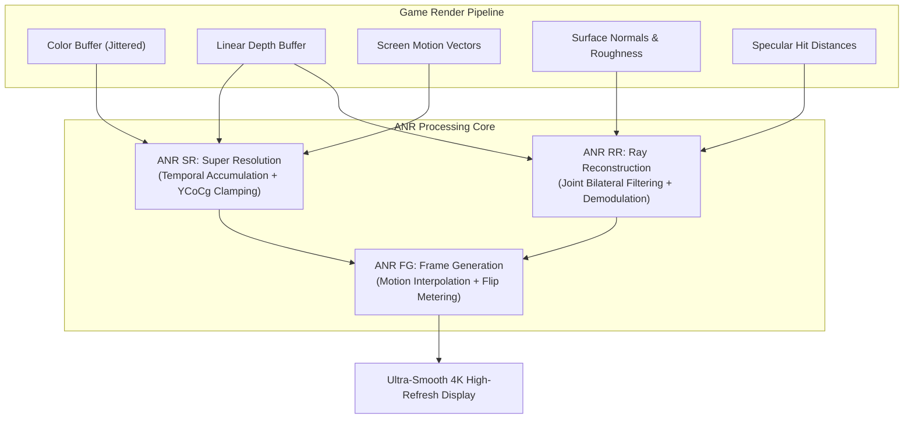
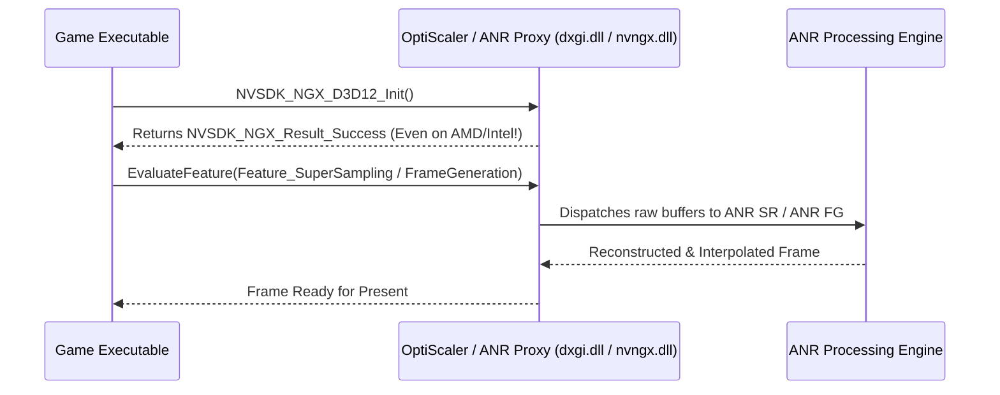

# Apex Neural Rendering (ANR) — Architecture & User Guide

This guide provides an end-to-end explanation of how **Apex Neural Rendering (ANR)** functions under the hood, how it integrates with games, and step-by-step instructions for everyday gaming, recording, side-by-side benchmarking, and video export.

---

## Table of Contents
1. [Overview & Core Architecture](#1-overview--core-architecture)
   - [What is ANR?](#what-is-anr)
   - [The Three Engines (FG, SR, RR)](#the-three-engines-fg-sr-rr)
   - [How Game Hooking Works (NGX Spoofing)](#how-game-hooking-works-ngx-spoofing)
   - [Why Game Menus Display "DLSS"](#why-game-menus-display-dlss)
2. [How to Use ANR for Gaming](#2-how-to-use-anr-for-gaming)
   - [Method A: ANR Studio GUI (Recommended)](#method-a-anr-studio-gui-recommended)
   - [Method B: Command-Line Installer](#method-b-command-line-installer)
   - [In-Game Controls & Hotkeys](#in-game-controls--hotkeys)
   - [The In-Game OptiScaler Overlay (`Insert` Key)](#the-in-game-optiscaler-overlay-insert-key)
3. [Recording, Replaying & Benchmarking](#3-recording-replaying--benchmarking)
   - [Capturing Gameplay (F6 & F9)](#capturing-gameplay-f6--f9)
   - [Interactive Side-by-Side Comparison (nr_compare)](#interactive-side-by-side-comparison-nr_compare)
   - [Hardware-Accelerated Video Export (nr_export)](#hardware-accelerated-video-export-nr_export)
   - [Objective Mathematical Metrics (nr_metrics)](#objective-mathematical-metrics-nr_metrics)
4. [Customizing In-Game Menu Names (e.g. Dune / Unreal Engine)](#4-customizing-in-game-menu-names-eg-dune--unreal-engine)
5. [Building from Source](#5-building-from-source)
6. [Troubleshooting & Best Practices](#6-troubleshooting--best-practices)

---

## 1. Overview & Core Architecture

### What is ANR?
Apex Neural Rendering (ANR) is a high-performance, vendor-agnostic graphics enhancement suite. It provides cutting-edge neural super-resolution, optical flow frame generation, and ray tracing reconstruction across **all major GPUs**:
- **NVIDIA GeForce**: RTX 20, 30, 40, and 50 series, and GTX 16 series.
- **AMD Radeon**: RX 5000, 6000, 7000, and 9000 series, and Steam Deck.
- **Intel Arc**: A-series and B-series.
- **Operating Systems**: Windows 10/11 and Linux/SteamOS (via Proton/Wine).

---

### The Three Engines (FG, SR, RR)



1. **ANR FG (Frame Generation)**:
   - Interpolates intermediate frames between rendered frames using motion vectors, depth, and optical flow estimation.
   - Includes **Hardware Flip Metering** and **Reflex/Anti-Lag Pacing** to keep frame delivery smooth and input latency ultra-low.
2. **ANR SR (Super Resolution)**:
   - Reconstructs a crisp high-resolution frame (e.g. 1440p or 4K) from a lower internal render resolution (e.g. 1080p).
   - Features sub-pixel jitter cancellation, motion vector reprojection, and **YCoCg color-space variance clipping** to completely suppress temporal ghosting and edge smearing.
3. **ANR RR (Ray Reconstruction)**:
   - Replaces traditional multi-stage spatial-temporal denoisers in ray tracing and path tracing pipelines.
   - Employs **Joint Bilateral Filtering** guided by surface normals, depth, and roughness, combined with **virtual parallax specular reprojection** and irradiance demodulation/remodulation.

---

### How Game Hooking Works (NGX Spoofing)

Most commercial games (like *Cyberpunk 2077*, *Dune: Awakening*, *Spider-Man*, or *Alan Wake 2*) are built specifically to call NVIDIA's proprietary Streamline / NGX SDK:



ANR and OptiScaler act as proxy libraries placed in the game directory. When the game loads, Windows loads the proxy instead of the system graphics runtime. When the game queries whether DLSS is supported, the proxy intercepts the call and answers **Yes**, allowing non-NVIDIA GPUs or unsupported hardware to enable these features.

---

### Why Game Menus Display "DLSS"

- **The text is hardcoded in the game**: Game developers compile strings like `"NVIDIA DLSS"` and `"DLSS Frame Generation"` directly into the game's executable and UI assets.
- **The game is unaware of modding wrappers**: The game believes it is calling NVIDIA's official driver. Behind the scenes, ANR captures those exact calls and executes ANR's algorithms instead.
- **Rule of Thumb**:
  - Flipping the game's **DLSS** switch to ON activates **ANR SR**.
  - Flipping the game's **DLSS Frame Generation** switch to ON activates **ANR FG**.
  - Flipping the game's **DLSS Ray Reconstruction** switch to ON activates **ANR RR**.

---

## 2. How to Use ANR for Gaming

### Method A: ANR Studio GUI (Recommended)

ANR Studio provides a native graphical interface to configure and launch games with one click:

1. **Open ANR Studio**:
   ```powershell
   python tools/anr_studio.py
   # Or using PowerShell:
   .\tools\anr_studio.ps1
   ```
2. **Scan Installed Games**: Click the **Scan Games** button. ANR Studio automatically detects Steam, Epic Games, and custom directory installations.
3. **Select Your Settings**:
   - **Super Resolution Upscaler**: Choose `Apex Neural Rendering (ANR SR) — Native` (or XeSS / FSR / DLSS).
   - **Frame Generation Engine**: Choose `Apex Neural Rendering (ANR FG)` (or FSR FG / XeSS-FG / DLSS-G).
   - **Ray Reconstruction**: Choose `Apex Neural Rendering (ANR RR) — Native Neural Denoiser`.
   - **Frame Pacing & Latency**:
     - Check **Low-Latency Reflex / Anti-Lag Pacing** (eliminates queue latency).
     - Check **Hardware Flip Metering** (for smooth frame times on AMD RDNA3/4 and NVIDIA Ada/Blackwell).
     - Check **Bypass UI Interpolation** if the game has floating health bars or HUD jitter.
4. **Click "Install & Launch"**: The configuration files (`OptiScaler.ini` and `nr_record.ini`) are automatically generated and the game launches immediately.

---

### Method B: Command-Line Installer

If you prefer using the command prompt or terminal:

1. **Scan your library**:
   ```bat
   python tools/game_installer.py --scan
   ```
   *Lists every detected game and its assigned number.*

2. **Install ANR hooks**:
   ```bat
   python tools/game_installer.py --install <game_number> --upscaler anr --fg-provider anr
   ```

3. **Launch the game normally** (via Steam, Epic, or desktop shortcut):
   - In the game's Video/Graphics options, turn on **DLSS** and **Frame Generation**.

4. **To uninstall and restore original files**:
   ```bat
   python tools/game_installer.py --uninstall <game_number>
   ```

---

### In-Game Controls & Hotkeys

While playing with ANR installed:

| Key | Function | Description |
| :--- | :--- | :--- |
| **`Insert`** | **OptiScaler On-Screen HUD** | Opens the live in-game configuration menu. |
| **`F6`** | **Toggle Recording** | Starts and stops continuous lossless input recording. |
| **`F9`** | **Snapshot 8 Frames** | Captures the next 8 frames losslessly for micro-stutter inspection. |

> [!NOTE]
> Captures are saved to `%LOCALAPPDATA%\nr-record\` on Windows, or `~/.local/share/nr-record/` on Linux/Proton.

---

### The In-Game OptiScaler Overlay (`Insert` Key)

When you press **`Insert`** inside the game, an on-screen menu opens directly over the gameplay:
- **Upscaler Selection**: Switch on the fly between `ANR SR (nr-record)`, `XeSS`, `FSR 3.1`, or native `DLSS`.
- **Frame Generation Engine**: Switch live between `ANR FG`, `FSR FG`, or `DLSS-G`.
- **Render Scale Ratio**: Fine-tune render resolution scale from 33% (Ultra Performance) to 100% (Native AA / DLAA).
- **Sharpness & RCAS**: Adjust contrast-adaptive sharpening sliders in real-time.

---

## 3. Recording, Replaying & Benchmarking

ANR includes a suite of recording and analysis tools to compare visual fidelity across different upscalers and frame generation engines on identical gameplay frames.

### Capturing Gameplay (F6 & F9)
1. In-game, press **`F6`** to begin recording. A brief audio cue confirms the start.
2. Play through the scene you want to test (e.g. high-speed camera motion, fine foliage, ray-traced reflections).
3. Press **`F6`** again to finish. The recorded directory contains raw color buffers, depth, motion vectors, and frame parameters.

---

### Interactive Side-by-Side Comparison (nr_compare)

To see the exact difference between ANR and DLSS or FSR:

```bat
python tools/nr_compare.py --record "<path_to_capture>" --generator anr --label "ANR" --b-generator nvidia --b-label "DLSS" --view
```

- Launches an interactive comparison viewer.
- **Split-Screen Slider**: Drag the divider across the screen to compare pixel sharpness.
- **Pixel-Peep Zoom**: Magnify fine details (chainlink fences, text, hair, particles).
- **Frame Stepping**: Step forward and backward frame-by-frame using arrow keys to examine disocclusion artifacts.

---

### Hardware-Accelerated Video Export (nr_export)

Convert raw capture sequences into high-bitrate MP4 videos for sharing:

```bat
python tools/nr_export.py --input "<path_to_capture>" --codec hevc --preset quality --out "comparison.mp4"
```

- Automatically queries and uses your GPU's dedicated hardware encoder:
  - **NVIDIA**: `hevc_nvenc` / `av1_nvenc`
  - **AMD**: `hevc_amf` / `av1_amf`
  - **Intel**: `hevc_qsv` / `av1_qsv`
  - **Apple Silicon**: `hevc_videotoolbox`

---

### Objective Mathematical Metrics (nr_metrics)

Run mathematical visual fidelity benchmarks:

```bat
python tools/nr_metrics.py --ref "<ground_truth_folder>" --test "<generated_folder>"
```

Outputs objective scores:
- **PSNR (Peak Signal-to-Noise Ratio)**: Measures reconstruction fidelity in decibels (higher is better).
- **SSIM (Structural Similarity Index)**: Measures human-perceived structural accuracy (closer to 1.0 is better).
- **Temporal Stability Score**: Quantifies pixel shimmering, crawling lines, and temporal flicker across consecutive frames.

---

## 4. Customizing In-Game Menu Names (e.g. Dune / Unreal Engine)

Because games hardcode the text `"NVIDIA DLSS"` in their menus, some users want the menu to say `"Apex Neural Rendering (ANR SR)"` instead.

In Unreal Engine titles (such as *Dune: Awakening*):
1. **Unpack Localization**: Use **FModel** or **UAssetGUI** on the game's `.pak` files in `Dune/Content/Paks/`.
2. Locate `Engine/Content/Localization/Engine/en/Engine.locres` (or `Game.locres`).
3. Search for the key `"NVIDIA DLSS"` and edit its translation string to `"Apex Neural Rendering (ANR SR)"`.
4. Repack the file with **UnrealPak** as `pakchunk99-ANR_UI_P.pak` and place it in `<GameDirectory>/Content/Paks/~mods/`.

> [!CAUTION]
> If playing on **official multiplayer servers protected by Easy Anti-Cheat (EAC)**, modifying `.pak` files or injecting memory scripts can trigger anti-cheat kicks or bans. For online games, simply leave the menu as "DLSS" and use the in-game **`Insert`** HUD overlay.

---

## 5. Building from Source

If you want to compile the native C++ libraries and executables yourself:

### Using CMake (Recommended on Windows with Visual Studio 2022)
```bat
# Configure
cmake -B build -G "Visual Studio 17 2022" -A x64

# Build Release binaries
cmake --build build --config Release
```

### Using Bazel (Linux, macOS, and Windows Cross-Compilation)
```bash
# Build recorder and replay tools
bazel build //record:nr-record //record/replay:nr-video //renderer

# Windows cross-compilation package
bazel build --config=windows_cross //record/capture:package //record/replay:nr-replay
```

Binaries will be placed in `build/bin/Release/` or `bazel-bin/`.

---

## 6. Troubleshooting & Best Practices

| Symptom | Cause | Solution |
| :--- | :--- | :--- |
| **Game crashes on startup** | Conflicting overlay software (RivaTuner, GeForce Experience, Discord) | Add game executable to RivaTuner exclusion list or disable third-party hooks. |
| **DLSS option is greyed out in game** | DXGI hook not loaded | Ensure `dxgi.dll` or `OptiScaler.ini` is in the directory containing the actual game `.exe` (not the launcher). |
| **HUD / Minimap jitters or shakes** | Optical flow interpolating 2D UI elements | Check **Bypass UI Interpolation** in ANR Studio or toggle UI depth masking in OptiScaler (`Insert` menu). |
| **Micro-stutters during high refresh gaming** | Display flip queue misaligned with GPU pacing | Enable **Hardware Flip Metering** and **Reflex / Anti-Lag Pacing** in ANR Studio. |
| **Artifacts behind moving transparent glass/particles** | Reactive mask missing in game engine | In the OptiScaler `Insert` menu, adjust the **Reactive Mask Sensitivity** slider. |

---

## Script & Tool Quick Links
- [tools/anr_studio.py](file:///c:/Users/ramko/Downloads/hmm/ANR/tools/anr_studio.py) — 1-Click GUI launcher & game manager
- [tools/game_installer.py](file:///c:/Users/ramko/Downloads/hmm/ANR/tools/game_installer.py) — CLI library scanner and installer
- [tools/nr_compare.py](file:///c:/Users/ramko/Downloads/hmm/ANR/tools/nr_compare.py) — Side-by-side comparison runner & viewer
- [tools/nr_export.py](file:///c:/Users/ramko/Downloads/hmm/ANR/tools/nr_export.py) — Hardware video encoder exporter
- [tools/nr_metrics.py](file:///c:/Users/ramko/Downloads/hmm/ANR/tools/nr_metrics.py) — Mathematical benchmark evaluator (PSNR, SSIM)
- [record/anr_sr_upscaler.cpp](file:///c:/Users/ramko/Downloads/hmm/ANR/record/anr_sr_upscaler.cpp) — Core ANR SR Super Resolution engine
- [record/anr_rr_denoiser.cpp](file:///c:/Users/ramko/Downloads/hmm/ANR/record/anr_rr_denoiser.cpp) — Core ANR RR Ray Reconstruction neural denoiser
